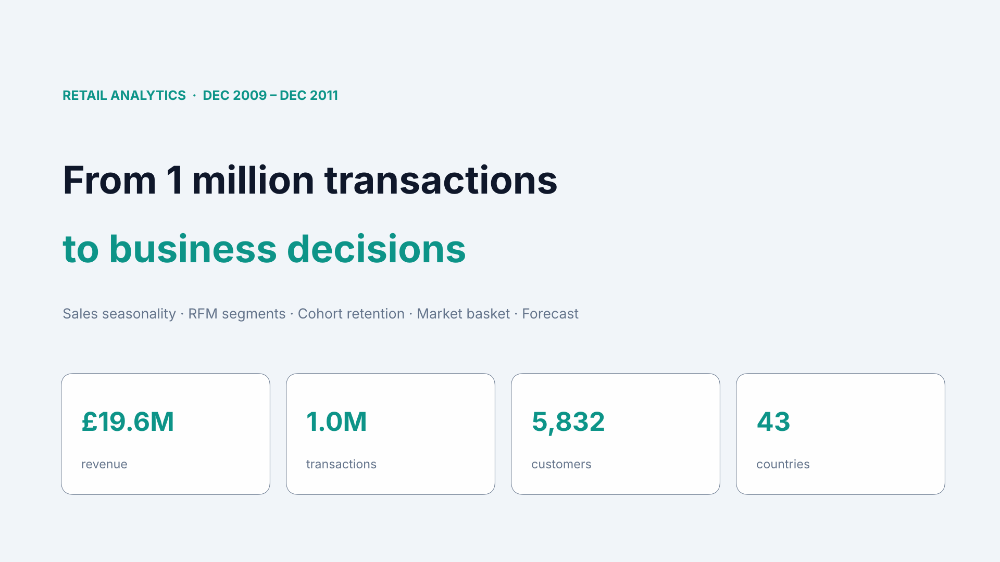
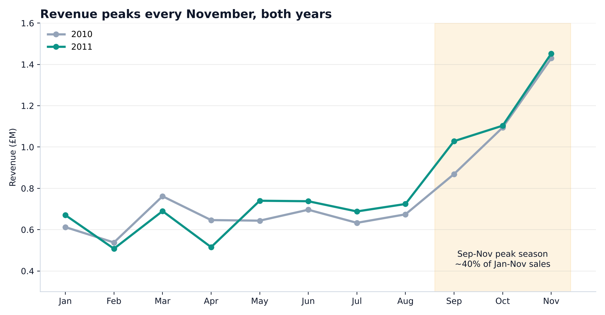
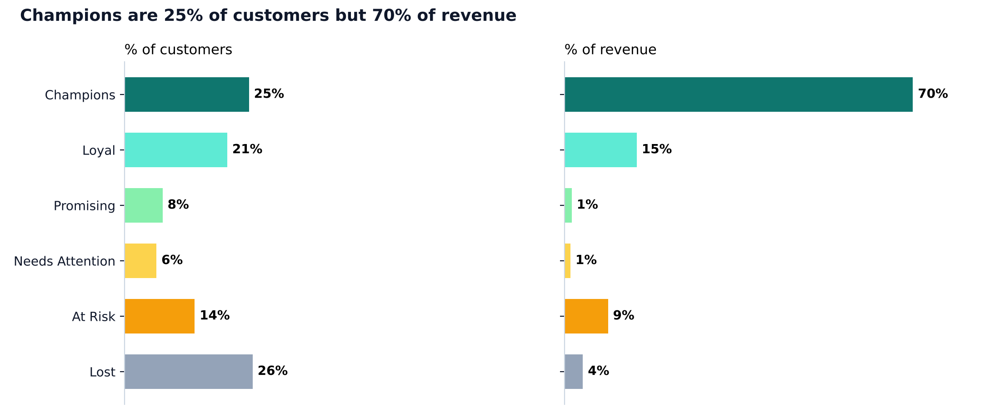
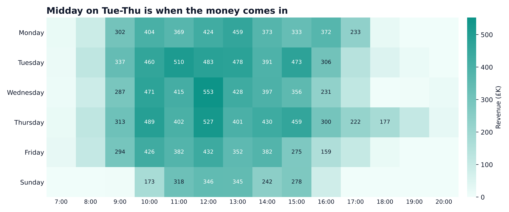
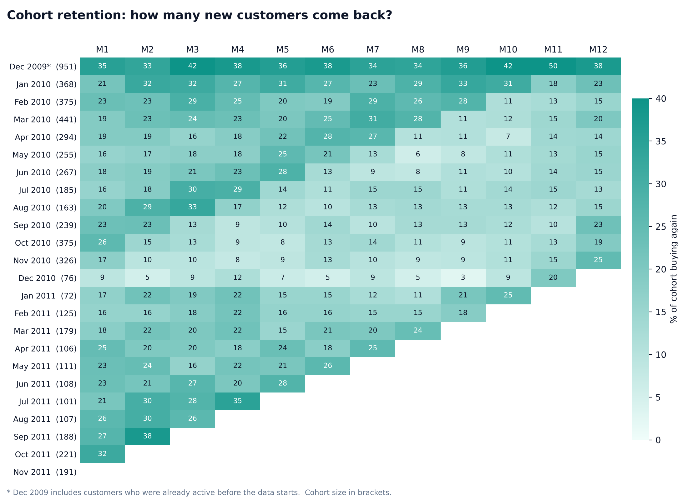

<p align="center"></p>

# 🛍️ Online Retail Analytics: from 1M transactions to business decisions

End-to-end analysis of an online gift retailer (Online Retail II, Dec 2009 – Dec 2011): data cleaning, sales seasonality, geography and products, customer behaviour, RFM segmentation, cohort retention, market basket and a forecast.

**Deliverables:** [Live dashboard](https://mohamedlamiaa291-bit.github.io/online-retail-analytics/dashboard.html) · [`output/Online_Retail_Dashboard.pdf`](output/Online_Retail_Dashboard.pdf) (report)

## 📌 Executive summary

| # | Insight | Recommendation |
|---|---|---|
| 1 | Sep–Nov brings ~40% of Jan–Nov sales; November alone is ~16% | Prepare stock and campaigns from August |
| 2 | 2011 revenue grew +3% via larger baskets (+7%) while orders fell 3.7% | Grow order count with second-order and re-engagement offers |
| 3 | Top 20% of customers = 77% of revenue; top 1% = 31% | Protect Champions with a loyalty programme |
| 4 | 826 “At Risk” customers (£1.4M past revenue) have gone quiet | Run a win-back campaign |
| 5 | Only ~20% of new customers return in month 1; Sep–Nov new customers fell 36% (partly a data-start effect, see limitations) | Add a second-purchase incentive and track acquisition over a longer history |
| 6 | Ireland earns £623K from only 3 customers | Reduce concentration; grow Germany and France |
| 7 | Matching party items are bought together: paper cups + plates (lift 27×), Red Retrospot bowl + cup (16×), napkins + plates (11×) | Bundle and cross-sell |

## 🖼️ Highlights

<p align="center">
 <br>
 
</p>

## 🗂️ Chapters

| Chapter | Script | Output (in `output/`) |
|---|---|---|
| 1. Data cleaning | `01_cleaning.py` | `sales_clean.csv`, `customers_clean.csv`, `cancelled.csv`, `cleaning_summary.csv` |
| 2. Sales overview | `02_sales_overview.py` | `ch2_*.png` |
| 3. Geography and products | `03_geography_products.py` | `ch3_*.png` |
| 4. Behaviour (heatmap) | `04_behavior.py` | `ch4_*.png` |
| 5. RFM segmentation | `05_rfm.py` | `ch5_*.png`, `rfm_customers.csv` |
| 6. Cohort retention | `06_cohort_retention.py` | `ch6_*.png`, `cohort_retention.csv` |
| 7. Market basket and forecast | `07_basket_forecast.py` | `basket_rules.csv`, `forecast.csv`, `dashboard_data.json` |
| Cover images | `08_cover.py` | `cover_*.png` |
| PDF report | `09_report_pdf.py` | `Online_Retail_Dashboard.pdf` |

## ▶️ Run it

1. Get **Online Retail II** from the [UCI repository](https://archive.ics.uci.edu/dataset/502/online+retail+ii).
2. Prepare it as `data/online_retail_cleaned.csv` with these columns: `Invoice`, `StockCode`, `Description`, `Quantity`, `InvoiceDate`, `Price`, `Customer ID`, `Country`, `TotalAmount` (= Quantity × Price), `Status` (`Completed` / `Cancelled`, from invoices starting with “C”), `Year`, `Month`, `YearMonth` (e.g. `2011-12`), `DayOfWeek`, `Hour`.
3. Install and run:

```bash
pip install -r requirements.txt
python 01_cleaning.py && python 02_sales_overview.py && python 03_geography_products.py
python 04_behavior.py && python 05_rfm.py && python 06_cohort_retention.py && python 07_basket_forecast.py
python 08_cover.py && python 09_report_pdf.py   # optional: cover images and PDF
```

Paths are relative to the repo, so it runs from any machine. Large cleaned CSVs are not stored in the repo (see `.gitignore`); `01_cleaning.py` re-creates them in `output/`.

## 🧪 Method notes

- **Cancellations** are kept in a separate table. Customer value in RFM is **net of cancellations**, which also neutralises the two largest orders (£168K and £77K), both cancelled afterwards.
- **Incomplete month:** Dec 2011 ends on the 9th, so it is excluded from comparisons, cohorts and the forecast.
- **Dec 2009 cohort** contains customers already active before the data starts, so it is excluded from retention averages.
- **Forecast:** seasonal model (same month last year × growth 1.025). Backtest on Jan–Nov 2011:
  - **9.3% MAPE** for plain seasonal-naive (the honest figure, no look-ahead);
  - 8.8% when scaled by the 2011/2010 ratio, but that ratio comes from the test period itself, so it is optimistic;
  - 28.1% for a 3-month moving average, which is a weak baseline for seasonal data.

  With only two years of data it is a baseline, not a precise prediction. The first 9 days of Dec 2011 (extreme lines excluded) were +9% versus the same days in 2010, so the December forecast is slightly conservative.
- **Market basket:** top 250 products, pairs with support ≥ 1%, ranked by lift. Pairs that are colour/design/size variants of one product (they share two or more content words once colours, sizes and counts are removed) are flagged in `basket_rules.csv` (`variant_pair`) and left out of the headline results. Two different plural nouns in one range (cups + plates) count as a bundle. It is a text rule, so it is imperfect.

## ⚠️ Limitations

- **New-customer decline (−36%) is partly an artefact.** The data starts in Dec 2009, so customers “first seen” in 2010 include some who were already customers before. That inflates 2010 new-customer counts relative to 2011. Treat the size of the drop with caution.
- **Retention curve:** it averages the 11 cohorts of Jan–Nov 2010, all observed for 12 months, so the cohort mix is the same at every point. The month-12 bump is led by the Sep–Nov 2010 cohorts (+13, +6, +10 points versus month 11), i.e. customers coming back in the next peak season. Calling it an annual repeat purchase is still an interpretation.
- **2011 vs 2010 retention:** like-for-like (same calendar cohorts), 2011 is slightly better in month 1 (22.7% vs 20.1%) but behind by month 3 (21.8% vs 25.2%), so there is no clear improvement.
- **Wholesale / trade buyers:** larger export orders and a business-hours buying pattern are consistent with trade customers, but customer type is not in the data.
- **Market basket:** lift is computed on baskets of ~35K invoices; the variant filter above is a heuristic, so a few variant pairs may remain and a few real bundles may be dropped.
- **Missing Customer ID:** ~13% of revenue has no Customer ID; it is used for sales analysis but not for RFM or cohorts.

**Tools:** Python, pandas, matplotlib, reportlab · **Dataset:** Online Retail II (UCI Machine Learning Repository)
